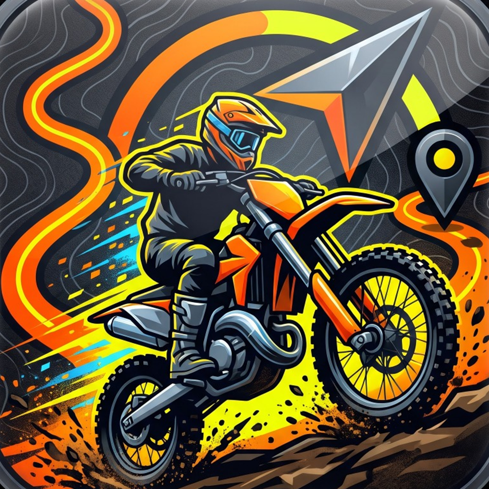

<p align="center">
  
</p>

# EnduLink (`motillOS` en iOS) · Navegación Off-Road GPX & Envío Wi-Fi a Pantalla TFT de Moto

Navegador GPX interactivo multiplataforma para **Android** e **iOS** desarrollado con **Kotlin Multiplatform (KMP)** y **Compose Multiplatform**.

Transmite el mapa de navegación en directo por Wi-Fi a cuadros TFT de motocicleta compatibles con **EasyConn / Carbit Ride** (`592 × 816`, vídeo H.264 por hardware a 15 FPS) como Rieju Aventura 500/307, CFMoto, Voge o Benelli, funcionando **con el móvil bloqueado en el bolsillo**, conservando los datos móviles 4G/5G activos y permitiendo su uso **100 % offline / en modo avión** si llevas los mapas descargados.

---

## Novedades y Características Principales (`v0.2.0`)

1. **Mapa Interactivo de Alto Rendimiento (Android + iOS):**
   - Motor gráfico optimizado en **Compose Canvas / Skia** (y fondo nativo Apple Maps cuando aplica en iOS).
   - Coordenadas Web Mercator pre-proyectadas, *viewport clipping* y diezmado sub-píxel de polilíneas y flechas de sentido para mantener fluidez a 60 FPS en el teléfono.
   - **Selección y edición directa desde el mapa:** Toca cualquier track GPX visible para abrir sus opciones (navegar, invertir sentido, descargar corredor offline, cambiar **nombre**, **color**, visibilidad o perfil de altitud).
   - **Flechas de dirección (`>>`)** integradas sobre tracks GPX, enlaces y rutas calculadas tanto en el móvil como en la pantalla TFT.
   - **Filtro anti-saltos GPS** y modos de seguimiento: *Libre*, *Centrado* y *Rumbo arriba*.

2. **Navegación Off-Road y Funcionamiento 100 % Offline / Modo Avión:**
   - **Algoritmo DMD2 de proyección ortogonal:** Detección de desvío fuera de ruta (`offTrackMeters`), cálculo por ventana local del índice de progreso y distancia restante (`remainingKm`).
   - **Reconexión dinámica adelantada y Modo Offline:** Si no hay cobertura o estás en modo avión, el enlace hacia rutas y tracks GPX funciona calculando ruta offline por pista/enlace directo y utilizando las teselas descargadas sin depender de Internet.
   - **Caché Topográfica + Parent Overzoom:** Descarga por regiones o por corredor alrededor de un GPX (*IGN MTN25*, *CyclOSM*, *OpenTopoMap*, ortofotos, *OSM*). Si falta un nivel de zoom en disco, escala instantáneamente desde niveles padre (`Z-1`..`Z-4`) sin bloquear el hilo de renderizado.
   - **Grabador en tiempo real (`REC`):** Filtro de parada inteligente y exportación `.gpx`.
   - **Waypoints y paradas intermedias:** Cancelas (`gate`), pasos técnicos (`rock`), agua (`water`), gasolineras (`fuel`) y peligros (`danger`).

3. **Transmisión de Vídeo H.264 por Hardware a la Moto (`592 × 816`):**
   - **Escáner QR nativo (Carbit/EasyConn y `WIFI:`):** Lee la URL QR de Carbit Ride, códigos de cuenta (`HJ-XXXXXX`) o códigos Wi-Fi estándar, guarda la red y asocia automáticamente el teléfono (Android: sugerencia WPA2 del sistema; iOS: `NEHotspotConfigurationManager`).
   - **Reconexión automática y ahorro de batería:** Al encender la moto y detectar el Wi-Fi de la pantalla (`DIRECT-HJ-*`, `192.168.43.1`, `192.168.49.1`, `192.168.169.1`, `192.168.10.1`), la app arranca el envío TFT automáticamente. Si pierde conexión o no detecta pantalla tras 3 minutos fuera del Wi-Fi de la moto, pausa la búsqueda activa (`knock` 10930) y detiene los servicios en segundo plano para no gastar batería.
   - **Auto-Zoom dinámico configurable por velocidad en TFT:** Configura libremente los umbrales de velocidad (*Lento / Trialera*, *Medio / Pista*, *Rápido / Carretera*) y el nivel de zoom exacto en cada rango.
   - **Codificación H.264 por hardware sincronizada:** `MediaCodec` (Android, con `BikeForegroundService`) y `VTCompressionSession` / VideoToolbox (iOS, con `BackgroundKeepAlive` activado únicamente durante sesiones o búsqueda activa).
   - **Enrutamiento multired:** Puertos TCP `10920` (Vídeo RV), `10921` (Control RV), `10922` (PXC) y `10930` (*Knock*) enlazados a la interfaz Wi-Fi de la moto sin perder datos 4G/5G ni bloquearse en modo avión (manteniendo el Wi-Fi activo).

---

## Arquitectura del Proyecto (Kotlin Multiplatform)

```text
EnduLinkV2/
├── shared/                             # Lógica, renderizado TFT y UI compartida (KMP)
│   ├── src/commonMain/kotlin/
│   │   ├── bike/                       # Protocolo EasyConn/Carbit (PXC/RV), BikeQr y escena TFT común
│   │   ├── trail/                      # Parser GPX, algoritmo DMD2, RoadRouter (online/offline), REC
│   │   ├── tiles/                      # TileStore con índice en memoria, Web Mercator y Parent Overzoom
│   │   ├── platform/                   # Interfaces expect (Location, H264Encoder, BackgroundService)
│   │   └── ui/                         # UI Compose Multiplatform (InteractiveMap, BikeConnectionSheet, Modales)
│   ├── src/androidMain/kotlin/         # MediaCodec H.264, CameraX+ZXing QR, Fused/LocationManager, WifiSuggestion
│   └── src/iosMain/kotlin/             # Puentes hacia VideoToolbox, CoreLocation y Wi-Fi/QR nativo
│
├── androidApp/                         # Aplicación Android (MainActivity, iconos adaptativos)
├── iosApp/                             # Wrapper SwiftUI iOS (motillOS: VideoToolboxBridge, QrScannerViewController, BackgroundKeepAlive)
│   └── project.yml                     # Configuración XcodeGen
├── Tools/
│   └── moto_falsa_wifi.py              # Simulador de pantalla TFT EasyConn/Carbit para PC
├── sidestore-source.json               # Fuente oficial de actualizaciones para SideStore (iOS)
└── .github/workflows/build-all.yml     # CI GitHub Actions (APK Android + IPA iOS sin firma en macOS 15)
```

---

## Compilación, Tests y Entregables

### 1. Android y KMP común (Windows / Linux / macOS)

Requisitos: JDK 17+ y Android SDK configurado.

```powershell
# Compilar APK Debug y Release + ejecutar tests unitarios KMP + verificar metadata común
.\gradlew.bat :androidApp:assembleRelease :androidApp:assembleDebug :shared:testDebugUnitTest :shared:compileCommonMainKotlinMetadata --console=plain

# Ruta del APK Release generado:
# androidApp/build/outputs/apk/release/androidApp-release.apk
```

### 2. iOS (GitHub Actions en `macos-15`)

El workflow `.github/workflows/build-all.yml` se ejecuta bajo demanda (`workflow_dispatch`) o automáticamente al subir un tag `v*`:

- **`EnduLink-Android-APK`**: APK de Android firmado listo para instalar (`androidApp-release.apk`).
- **`EnduLink-iOS-unsigned-ipa`**: Archivo `EnduLink-unsigned.ipa` listo para instalar en iPhone con **SideStore** (mediante `sidestore-source.json`) o **Sideloadly**.

---

## Simulador de Pantalla Wi-Fi en PC (Windows)

Para probar la conexión y el vídeo H.264 hacia el cuadro TFT sin tener la moto delante:

1. Conecta el PC y el teléfono a la misma red Wi-Fi local (o zona Wi-Fi).
2. Ejecuta en tu terminal:

```powershell
python Tools/moto_falsa_wifi.py <IP_DEL_MOVIL> salida.h264 45
ffplay -f h264 salida.h264
```
